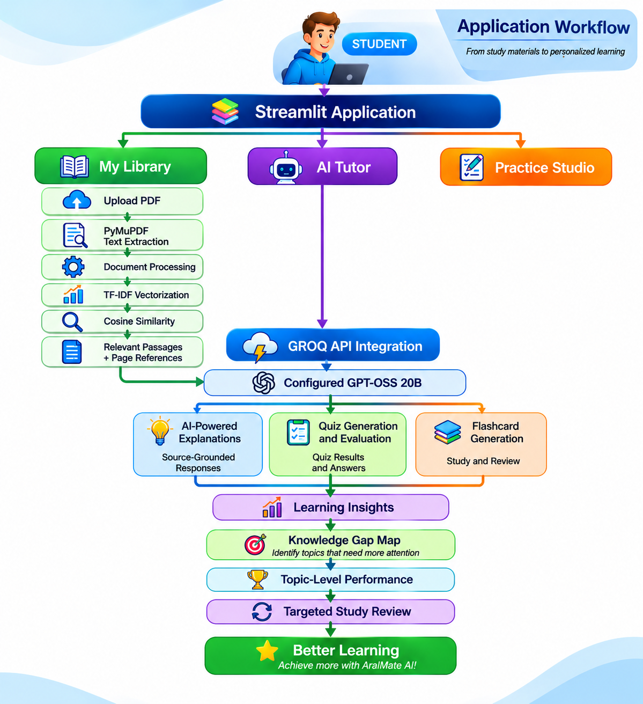
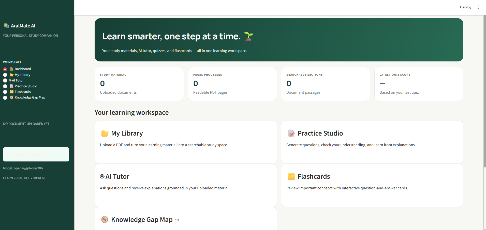
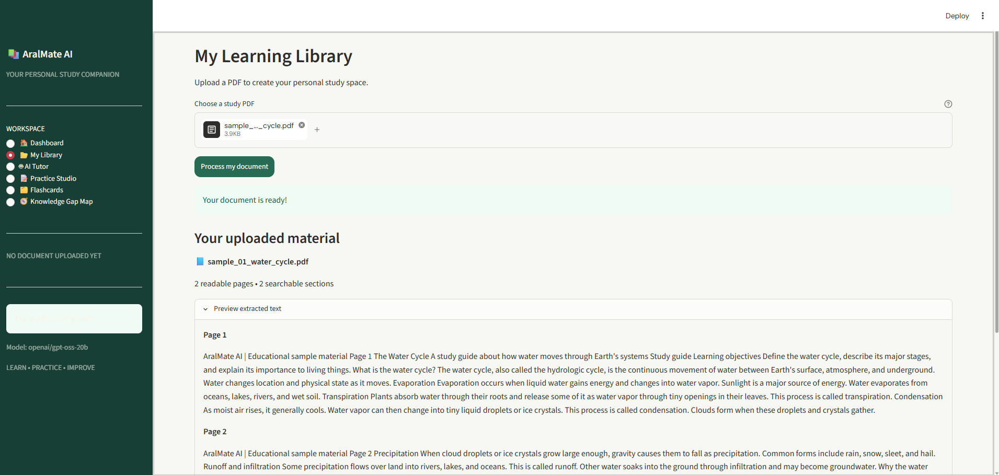
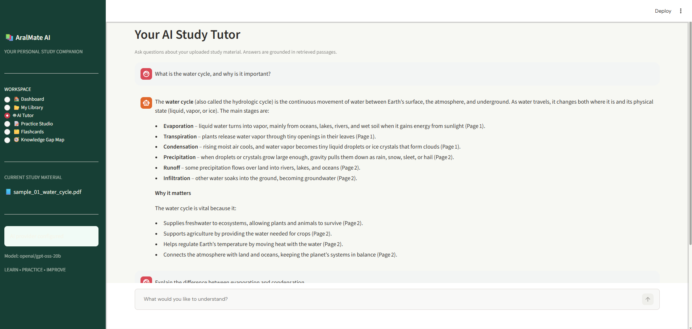
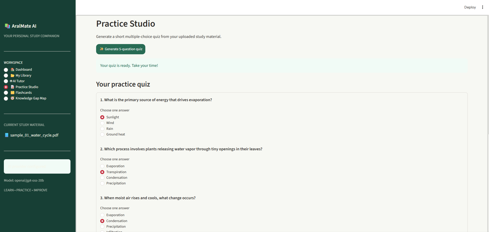
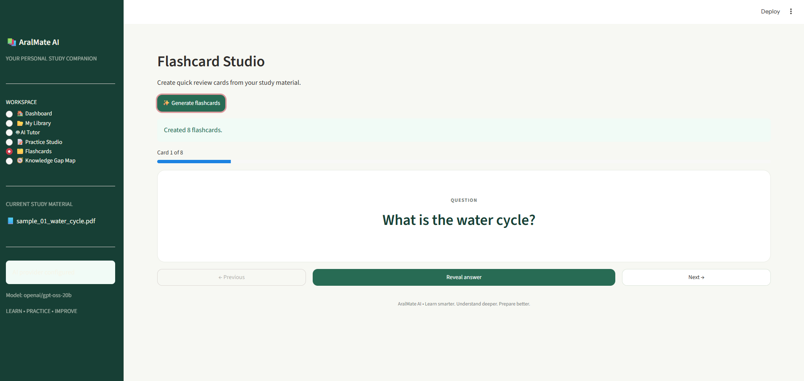
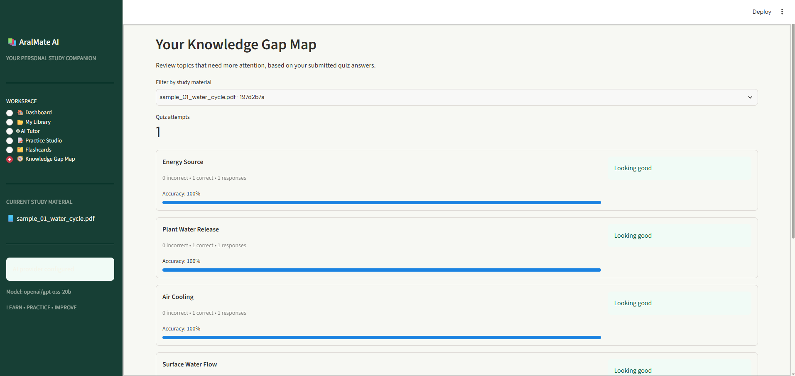

# 📚 AralMate AI

### Your Personal AI Study Companion

**Learn smarter. Understand deeper. Prepare better.**

AralMate AI is an AI-powered study companion that transforms PDF study materials into interactive learning experiences.

Upload learning materials, ask questions through an AI Tutor, generate practice quizzes, review flashcards, and identify topics that need more attention through a Knowledge Gap Map.

**LEARN • PRACTICE • IMPROVE**

---

## 🎯 The Problem

Students often work with lengthy PDF documents, lecture notes, and study materials. Finding relevant information, reviewing concepts, and identifying knowledge gaps can take time.

AralMate AI brings document-based assistance, active recall, practice assessments, and learning insights together in one application.

## 💡 Our Solution

AralMate AI provides a study workspace where learners can interact with their own uploaded materials instead of relying only on general-purpose AI responses.

## ✨ Key Features

### 📂 My Library
- Upload PDF study materials.
- Extract text from supported PDF documents.
- Use uploaded materials as the basis for study activities.

### 🤖 AI Tutor
- Ask questions about uploaded study materials.
- Receive explanations grounded in relevant document passages.
- View page references to help locate supporting information.

### 📝 Practice Studio
- Generate multiple-choice quizzes from study materials.
- Submit answers and review results.
- See correct answers and explanations.

### 🗂️ Flashcards
- Generate question-and-answer flashcards.
- Reveal answers interactively.
- Support active recall and concept review.

### 📊 Knowledge Gap Map
- Review performance using submitted quiz answers.
- Aggregate results by topic.
- Identify topics that may need more attention.
- Filter learning insights by study material.

### 🏠 Learning Dashboard
- Access the main study workspace.
- Navigate the application's learning features.

---

## 🌟 What Makes AralMate AI Different?

AralMate AI combines document-grounded learning with interactive practice and topic-level performance insights.

Its Knowledge Gap Map uses quiz responses to summarize performance by topic, helping learners decide what to review next instead of relying only on an overall quiz score.

The learning cycle:

**Upload → Understand → Practice → Review → Improve**

---

## 🧠 AI Implementation

AralMate AI uses a Groq-hosted language model through an OpenAI-compatible API interface.

### PDF Processing
- PyMuPDF extracts text from uploaded PDF documents.
- Extracted content is divided into searchable sections.
- Document content provides context for study interactions.

### Document Retrieval
- TF-IDF vectorization represents document sections.
- Cosine similarity identifies relevant passages.
- Retrieved passages provide context for document-grounded AI Tutor responses.

### AI-Powered Learning
The language model supports:
- Document-grounded question answering.
- Multiple-choice quiz generation.
- Flashcard generation.
- Explanations and learning assistance.

### Learning Insights
Quiz responses are recorded in Streamlit session state and aggregated by topic to generate the Knowledge Gap Map.

AI-generated content should be checked against the original study material.

---

## 🛠️ Technology Stack

| Technology | Purpose |
|---|---|
| Python | Main programming language |
| Streamlit | Interactive web application |
| PyMuPDF | PDF text extraction |
| scikit-learn | TF-IDF retrieval and cosine similarity |
| OpenAI Python SDK | API communication |
| Groq API | Hosted language-model inference |
| python-dotenv | Environment configuration |

---

## 🖥️ Application Workflow



### How the Workflow Works

1. **Upload Study Materials:** Students upload PDF study materials through My Library.

2. **Extract and Process Content:** PyMuPDF extracts text and page information from supported PDF documents.

3. **Retrieve Relevant Information:** The application uses scikit-learn's TF-IDF vectorization and cosine similarity to identify relevant document passages based on the student's question.

4. **Generate AI-Assisted Learning Content:** Relevant context and student prompts are sent through the Groq API using the OpenAI-compatible Python SDK and the configured GPT-OSS 20B model.

5. **Support Interactive Learning:** Students can ask questions through AI Tutor, generate and answer quizzes through Practice Studio, and create flashcards for reviewing important concepts.

6. **Analyze Learning Performance:** Submitted quiz answers are evaluated and organized into topic-level performance insights.

7. **Identify Knowledge Gaps:** The Knowledge Gap Map highlights topics that need additional attention, helping students focus their review efforts.

8. **Improve Continuously:** Students can revisit their learning materials, review weak topics, practice again, and monitor their progress.

---

## 🚀 Getting Started

### 1. Clone the repository

```bash
git clone https://github.com/jcdumlao14/AralMate-AI-.git
cd AralMate-AI
```

### 2. Create a virtual environment

Windows PowerShell:

```powershell
python -m venv .venv
.\.venv\Scripts\Activate.ps1
```

### 3. Install dependencies

```powershell
python -m pip install --upgrade pip
pip install -r requirements.txt
```

### 4. Configure the AI provider

Create a local environment file:

```powershell
Copy-Item .env.example .env
```

Edit `.env` and configure your Groq API key:

```env
GROQ_API_KEY=your_groq_api_key_here
GROQ_MODEL=openai/gpt-oss-20b
GROQ_BASE_URL=
```

The application uses the default Groq OpenAI-compatible API endpoint when no custom base URL is configured.

**Never publish your API key or commit your `.env` file to GitHub.**

### 5. Run the application

```powershell
python -m streamlit run app.py
```

Open the local address displayed in your terminal.

---

## 🧪 Verification

The repository includes an automated verification script.

Run:

```powershell
python verify_aralmate.py
```

The verification script checks application components and helper functions without requiring live Groq API calls.

---

## 📸 Screenshots and Demo

Explore the main features and user experience of AralMate AI through the application screenshots below.

### 1. Main Dashboard



### 2. My Library — Study Materials



### 3. AI Tutor — Document-Grounded Assistance



### 4. Practice Studio — Interactive Quizzes



### 5. Flashcards — Active Learning and Review



### 6. Knowledge Gap Map — Learning Insights



### 🎥 Demo Video

Watch the AralMate AI demonstration to see how students can upload study materials, interact with the AI Tutor, practice with quizzes, review flashcards, and identify topics that need further attention.

[▶ Watch the AralMate AI Demo Video](https://youtu.be/E9uBrUL3JxA)

## 👩‍💻 Project Contribution

This is an individual AI application project.

Development contributions include:

- Designing and developing the AralMate AI application.
- Implementing PDF text extraction and document processing.
- Developing TF-IDF-based document retrieval.
- Integrating a language model through the Groq API.
- Implementing document-grounded AI Tutor functionality.
- Developing quiz and flashcard generation.
- Implementing quiz validation and topic-level learning insights.
- Testing the application using sample PDF study materials.
- Preparing project documentation and demonstration materials.

### AI-Assisted Development

ChatGPT was used as an AI-assisted development tool for planning, debugging, code review, problem-solving, and documentation support.

The project implementation, integration, verification, and testing were part of the development work.

---

## 📚 What I Learned

Building AralMate AI provided practical experience in:

- Integrating a language model API into a Python application.
- Extracting and processing PDF text.
- Implementing TF-IDF-based information retrieval.
- Grounding AI responses in uploaded learning materials.
- Designing AI-generated quizzes and flashcards.
- Validating generated assessment content.
- Turning quiz responses into topic-level learning insights.
- Testing and improving an interactive AI application.

---

## ⚙️ Current Prototype Limitations

- Supports text-based PDF documents; OCR for scanned PDFs is not included.
- Uses TF-IDF retrieval rather than vector embeddings.
- AI Tutor, quiz, and flashcard generation require a configured AI provider.
- Quiz history and learning insights are maintained in Streamlit session state, not a permanent database.
- Learning history may reset when the application session restarts.
- AI-generated content can contain errors and should be checked against the original material.

---

## 🔐 Privacy and Security

- API credentials are loaded through environment variables.
- The `.env` file is excluded from version control.
- Uploaded study documents are not intended to be committed to the Git repository.
- Avoid uploading confidential or sensitive documents to an AI service unless you have permission and understand its data-handling terms.

---

## 🎓 Project Goal

AralMate AI aims to make studying more interactive, organized, and focused.

By combining document-grounded assistance, active recall, practice assessments, and topic-level learning insights, it helps learners build a more structured study experience.

**LEARN • PRACTICE • IMPROVE**

---

## 🙏 Third-Party Technologies and Acknowledgments

AralMate AI is built using the following open-source technologies and AI services:

- **Python** – Main programming language.
- **Streamlit** – Interactive web application framework.
- **PyMuPDF** – PDF text extraction and document processing.
- **scikit-learn** – TF-IDF vectorization and cosine similarity-based document retrieval.
- **OpenAI Python SDK** – API client for communicating with the Groq-compatible endpoint.
- **Groq** – Hosted AI inference service.
- **GPT-OSS 20B** – Configured language model used for AI-assisted learning.
- **python-dotenv** – Environment variable configuration.

Third-party technologies, models, and services remain the property of their respective owners and are subject to their applicable licenses, terms, and usage policies.

AralMate AI is an independent project and is not affiliated with or officially endorsed by the maintainers of these technologies.

---
## 📄 Project Information

- **Project:** AralMate AI
- **Category:** Education / Artificial Intelligence
- **Application Type:** AI-powered study companion
- **Development:** Individual project
- **Repository:** https://github.com/jcdumlao14/AralMate-AI-
- **Hackathon:** Build Your First AI App 2026
- **Host:** Yasir Insights

---

*Built with curiosity, experimentation, and a passion for practical AI applications.*
